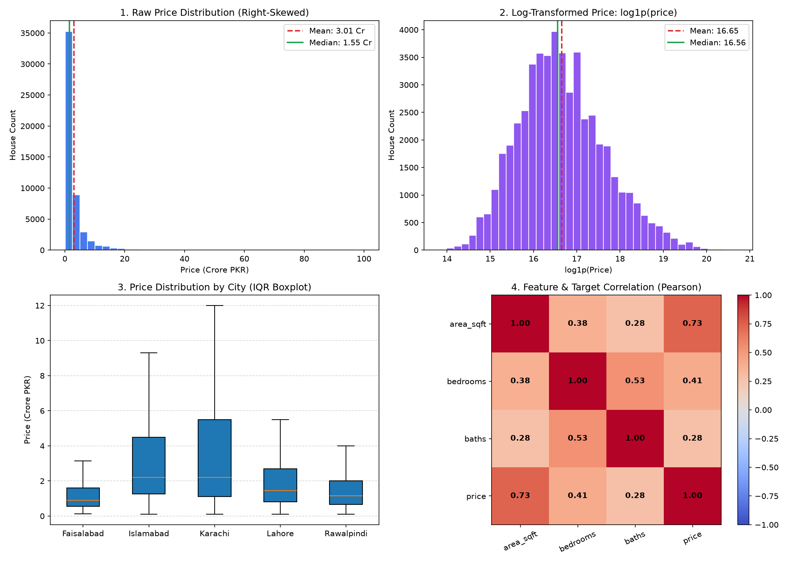

# Real-World EDA Report: Zameen.com Pakistan Housing (`ml-serving-skeleton`)

## 1. Data Cleaning & Retention Funnel
- **01_raw_total:** 191,393
- **02_houses_for_sale:** 93,809
- **03_valid_price_and_area:** 93,647
- **04_after_content_dedup:** 51,246

## 2. Univariate Distributions, Hidden Missingness & Skewness
| feature   |   non_null |   missing_pct |           mean |      median |         p99 |   skewness |
|:----------|-----------:|--------------:|---------------:|------------:|------------:|-----------:|
| area_sqft |      51246 |          0    | 2493.65        | 1642.5      | 13500       |      5.773 |
| bedrooms  |      45143 |         11.91 |    4.46        |    4        |    10       |      0.968 |
| baths     |      38820 |         24.25 |    4.58        |    4        |    10       |     80.337 |
| price     |      51246 |          0    |    3.00589e+07 |    1.55e+07 |     2.3e+08 |      5.914 |

- **Target Skewness Diagnosis:** Raw `price` skewness = `5.914` vs `log1p(price)` skewness = `0.413`.

## 3. City-Wise Market Insights
| city       |   houses |   median_price_pkr |   median_area_sqft |   median_pkr_per_sqft |
|:-----------|---------:|-------------------:|-------------------:|----------------------:|
| Karachi    |    11274 |          2.205e+07 |             1800   |              13425.9  |
| Islamabad  |     8635 |          2.2e+07   |             2092.5 |              10666.7  |
| Lahore     |    21432 |          1.45e+07  |             1575   |               9111.11 |
| Rawalpindi |     6865 |          1.15e+07  |             1575   |               7377.78 |
| Faisalabad |     3040 |          9e+06     |             1125   |               7777.78 |

## 4. Correlations (Pearson vs. Spearman)
### Pearson (Linear)
|           |   area_sqft |   bedrooms |   baths |   price |
|:----------|------------:|-----------:|--------:|--------:|
| area_sqft |       1     |      0.382 |   0.278 |   0.728 |
| bedrooms  |       0.382 |      1     |   0.534 |   0.405 |
| baths     |       0.278 |      0.534 |   1     |   0.279 |
| price     |       0.728 |      0.405 |   0.279 |   1     |

### Spearman (Monotonic)
|           |   area_sqft |   bedrooms |   baths |   price |
|:----------|------------:|-----------:|--------:|--------:|
| area_sqft |       1     |      0.556 |   0.615 |   0.847 |
| bedrooms  |       0.556 |      1     |   0.813 |   0.621 |
| baths     |       0.615 |      0.813 |   1     |   0.664 |
| price     |       0.847 |      0.621 |   0.664 |   1     |

